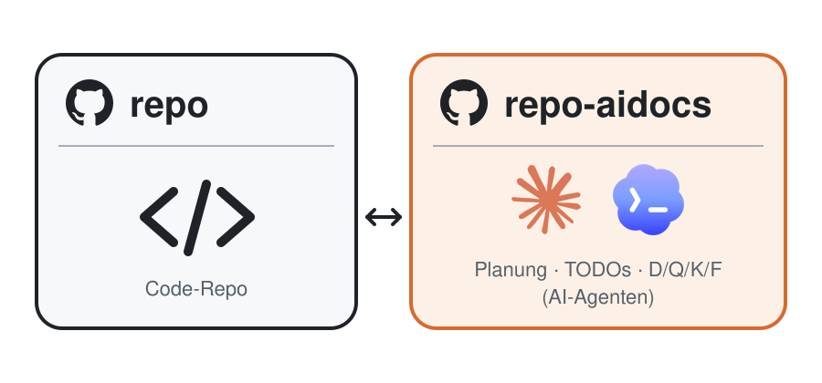
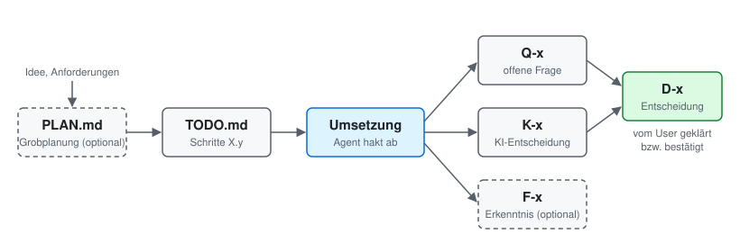

# .aidocs

Ein Muster für **AI-driven planning**: Plan, TODOs, Entscheidungen und offene Fragen eines Projekts liegen in einem eigenen Git-Repo und werden von KI-Agenten (Claude Code, Codex, …) gepflegt, nicht in Jira oder auf einem Kanban-Board.

Dieses Repo ist keine Vorlage zum Kopieren. Es beschreibt das Konzept so, dass ein Agent es auf ein bestehendes Projekt übertragen und dabei anpassen kann.

## Anwenden

Im Projekt, das das Muster bekommen soll, dem Agenten sagen:

> Lies https://github.com/simonottenhauskenbun/aidocs/blob/main/ANLEITUNG.md und richte das aidocs-Muster in diesem Repo ein. Frag nach, wo etwas unklar ist.

Der Agent analysiert das Repo, stellt Rückfragen (z. B. wo das Planungs-Repo liegen soll, welche Dokumente gebraucht werden) und richtet alles ein. Die Dateien unter [vorlage/](vorlage/) dienen ihm als Referenz, nicht als feste Struktur.

## Voraussetzungen

- **Git** mit Schreibzugriff auf Code-Repo und Planungs-Repo, ohne interaktive Passwortabfrage (SSH-Key oder Credential Manager), da der Agent selbständig pusht.
- **Python 3** (nur Standardbibliothek) für das Sync-Skript. Nicht nötig bei einem eigenständigen Planungs-Repo ohne Code-Repo.
- **Ein KI-Agent mit Shell-Zugriff**, z. B. Claude Code oder Codex.
- *Optional:* [gh CLI](https://cli.github.com/), damit der Agent das Planungs-Repo `<repo>-aidocs` selbst anlegen kann. Ohne gh legt man es manuell an.

Der Prozess wurde mit Claude Opus 5.5 bereits in mehreren Repos und Projekten getestet.

## Vorteile

- **Man muss nicht jede Agenten-Antwort lesen.** In langen Antworten verstecken sich oft Sätze wie „Was du wissen solltest: …“ oder „Ich habe entschieden: …“. Hier landen sie als Q-x, K-x oder F-x in Dateien, und der Agent nennt nach jedem Schritt eine kurze Liste der neuen Einträge.
- **Jederzeit eine neue Session starten.** Nichts hängt am Verlauf einer alten Session. Plan, Stand, Entscheidungen und offene Fragen stehen im Repo; man muss nicht in alten Sessions nach Informationen suchen.
- **Verboser Agenten-Output ist vom Code getrennt.** Pläne, Abwägungen, Erklärungen und Erkenntnisse der Agenten landen im Planungs-Repo, nicht als lange Kommentare, Notiz-Dateien oder Commit-Texte im Code-Repo. Code und Code-Historie bleiben schlank, und das Planungs-Repo kann privat bleiben, auch wenn der Code öffentlich ist.
- **Alle sind automatisch auf dem aktuellen Stand.** Agenten committen und pushen jede Änderung sofort, und jede Session holt den neuesten Stand. Das ganze Team und alle Agenten arbeiten mit derselben Planung.
- **Der Prozess lässt sich jederzeit anpassen.** Die Struktur ist nicht fest vorgegeben, sondern steht als Text im Repo. Neue Benennungsschemata (z. B. R-x für Risiken) oder neue Informationsflüsse (z. B. Erkenntnisse, die automatisch in eine Doku wandern) lassen sich ergänzen, indem man den Agenten bittet, die Regeln entsprechend zu ändern.

## Workflow

**Initiale Planung**

User-Idee bzw. Projektanforderungen und weitere Informationen → `PLAN.md` (Grobplanung, mit dem Agenten iterieren) → in `TODO.md` überführen. `PLAN.md` ist optional; bei kleinen Vorhaben entsteht die TODO-Liste direkt.

**TODO ändern**

- „Füge neuen Schritt X.y hinzu: …“
- „Streiche Schritt X.y.“

**Umsetzen**

- „Setze TODO-Schritt X.y um.“ Der Agent implementiert, hakt ab und legt bei Bedarf neue Fragen (Q-x), Agenten-Entscheidungen (K-x) und Erkenntnisse (F-x) an. Danach nennt er sie zuerst in einer kurzen Liste.
- Fragen beantworten bzw. Agenten-Entscheidungen bestätigen: Sie werden zu Entscheidungen (D-x).

## Die Idee in Kürze

- **Getrenntes Planungs-Repo.** Das Code-Repo `foo` bekommt ein Planungs-Repo `foo-aidocs`, ausgecheckt als `./.aidocs/` (gitignored, kein Submodul). Planung und Code haben getrennte Historien und getrennte Rechte; das Planungs-Repo kann privat bleiben, auch wenn der Code öffentlich ist.
- **Planung immer auf `main`.** Egal welcher Branch im Code-Repo ausgecheckt ist, `.aidocs/` steht auf `main`. Ein kleines Sync-Skript klont, wechselt und pullt automatisch (Git-Hook bei Branchwechsel, Session-Start-Hook des Agenten).
- **Agenten committen in `.aidocs/` selbständig**, sofort nach jeder Änderung, damit Konflikte mit anderen früh auffallen. Im Code-Repo committen sie nur auf Anweisung.
- **Stabile IDs statt Prosa.** Entscheidungen des Users (`D-x`), offene Fragen (`Q-x`) und noch zu bestätigende KI-Entscheidungen (`K-x`) stehen in eigenen Dateien; TODO und Plan verweisen nur per ID. Eine KI-Entscheidung wird nie als User-Entscheidung eingetragen. Jeder Eintrag nennt die Person, von der er stammt.
- **Kurze Liste nach jedem Schritt.** Nach jedem umgesetzten Schritt nennt der Agent zuerst die neuen Fragen, Agenten-Entscheidungen und Erkenntnisse, jeweils mit ID und einer Zeile.
- **Optional: Erkenntnisse ins Planungs-Repo, nicht in den Code.** Was beim Arbeiten herauskommt (Bug-Ursachen, Eigenheiten, Messergebnisse, Sackgassen), steht als `F-x` in `FINDINGS.md` statt als Code-Kommentar. Der Code bleibt sauber, das Wissen bleibt auffindbar.
- **Schlanke TODOs.** Erledigte Schritte werden abgehakt; Text nur, wenn es etwas Überraschendes gab. Optional für Teams: „Umgesetzt von <Name> auf <Branch>“ pro Arbeitspaket.

Variante ohne Code-Repo: Für reine Planungs- oder Prüfprojekte (z. B. Sicherheitsvorfälle über viele Systeme) ist das Planungs-Repo selbst das Arbeitsverzeichnis.

## Inhalt

| Datei | Zweck |
|---|---|
| [ANLEITUNG.md](ANLEITUNG.md) | Anleitung für den Agenten: Konzept, Rückfragen, Einrichtungsschritte |
| [vorlage/aidocs-repo/](vorlage/aidocs-repo/) | Beispiel-Dateien für das Planungs-Repo (README mit Agentenregeln, PLAN, TODO, DECISIONS, QUESTIONS, FINDINGS) |
| [vorlage/code-repo/](vorlage/code-repo/) | Beispiel-Dateien für das Code-Repo (Sync-Skript, Abschnitt für CLAUDE.md/AGENTS.md, Claude-Hook) |
| [docs/repos.svg](docs/repos.svg) | Diagramm Code-Repo und Planungs-Repo |
| [docs/informationsfluss.svg](docs/informationsfluss.svg) | Diagramm zum Informationsfluss |

## Alternativen

Ähnliche Ansätze, die Planung und Kontext für Agenten als Dateien ablegen (Stand November 2026). Sie liegen meist im Code-Repo selbst; ein getrenntes Planungs-Repo mit Auto-Commit ist dort nicht vorgesehen.

- [GitHub Spec Kit](https://github.com/github/spec-kit): Spec-Driven Development mit CLI; `constitution.md`, `spec.md`, `plan.md`, `tasks.md`.
- [Kiro](https://kiro.dev): Agentische IDE von AWS; Specs, Design und Task-Listen vor dem Code, „Steering“-Dateien als Projektkontext.
- [BMAD Method](https://github.com/bmad-code-org/BMAD-METHOD): Multi-Agenten-Framework mit Rollen (Analyst, PM, Architekt, Scrum Master, Dev, QA).
- [Agent OS](https://github.com/buildermethods/agent-os): Codebase-Standards und Specs für Spec-Driven Development.
- [Task Master AI](https://github.com/eyaltoledano/claude-task-master): Zerlegt ein PRD per CLI in eine abhängigkeitsbewusste Task-Liste.
- [Cline Memory Bank](https://cline.bot/blog/memory-bank-how-to-make-cline-an-ai-agent-that-never-forgets): Ordner `memory-bank/` mit Projektbrief, aktuellem Kontext und Fortschritt.
- [planning-with-files](https://github.com/OthmanAdi/planning-with-files): Skill für Claude Code u. a.; Plan-Dateien als „Arbeitsgedächtnis auf der Platte“, gitignored im Projekt.
- [specflow](https://pkg.go.dev/github.com/MatanKoby/specflow@v0.1.3): CLI, das ein `AGENTS.md`-Protokoll mit kleinen Spec-Dateien ins Repo schreibt.
- [spec-driven-dev-kit](https://github.com/trojava/spec-driven-dev-kit): Deutsches, werkzeugunabhängiges Template-Repo mit `AGENTS.md` und Skills.
- [Archiva](https://github.com/Jalkarna/archiva): Git-native Entscheidungs-Historie als CLI und MCP-Server, mit Claude-Code-Hooks.
- [agent-decision-log](https://pypi.org/project/agent-decision-log/): Append-only `decisions.txt` für Agenten-Entscheidungen.
- Architecture Decision Records (ADRs) für Agenten, z. B. [O'Reilly](https://www.oreilly.com/radar/?p=19867), [Duncan Davidson](https://duncandavidson.com/agents-love-decisions).

## Lizenz

[MIT](LICENSE)
